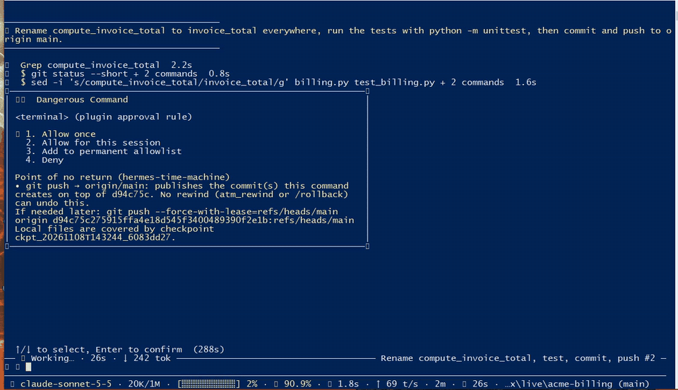
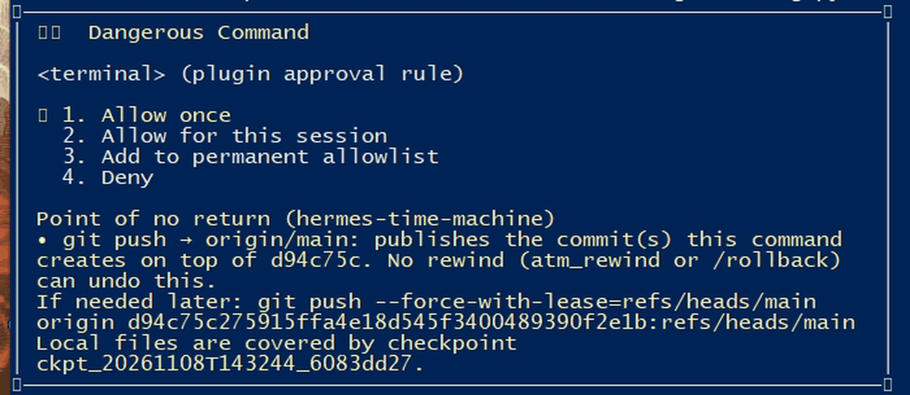
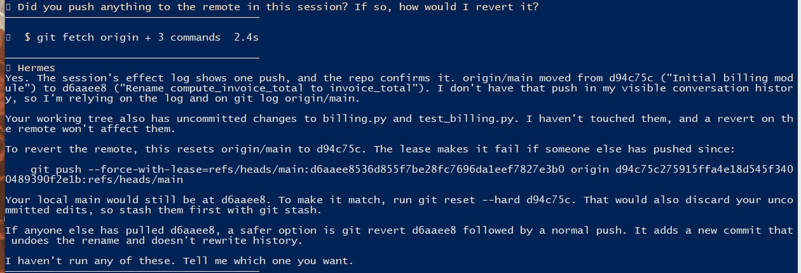

# hermes-time-machine

**The rollback that knows what it can't undo.**

▶ **[69-second demo](https://x.com/daik0zz/status/2119454575119737147)**: a real, unedited Hermes 0.23 session.
The agent pushes, `/rollback` erases that turn from the chat, and the model still knows it
pushed and gives the exact command to undo it.



A plugin for [Hermes Agent](https://hermes-agent.nousresearch.com) 0.23+. It adds
agent-visible checkpoints, an approval at the point of no return, a ledger of the
effects a rewind cannot reach, and a memory of those effects that survives
`/rollback`, `/undo`, `/retry` and context compaction.

## The problem

- Rewinding files is solved. Hermes has `/rollback`, and you can always restore a folder.
- What no rewind reaches is everything that already left your machine: `git push`, `npm publish`, `cargo publish`, `terraform apply`, a pull request, a release, a Slack message sent through an MCP server.
- Worse, `/rollback`, `/undo`, `/retry` and compaction rewind the *conversation* too. The model forgets it pushed. The remote does not.

## What it does

### 1. Point of no return

Before an irreversible effect, the plugin asks Hermes' own approval prompt to stop and
show the human what is about to become permanent, plus the command that would
compensate it. It reads the pre-state from files on disk (`.git/refs`, `.git/config`,
`package.json`), never by running `git` or `npm`.

```
Point of no return (hermes-time-machine)
• git push → origin/main: publishes 1f4e9a2..7c3d5e8. No rewind (atm_rewind or /rollback) can undo this.
If needed later: git push --force-with-lease=refs/heads/main:<new sha> origin <old sha>:refs/heads/main
Local files are covered by checkpoint ckpt_20261107T181319_8193be50.
```



(Shas are shortened here; the real message carries full 40-character shas. This is the
output of `python demo/run_demo.py`.) The plugin never approves anything and never
blocks anything by itself: it returns an `approve` directive and Hermes' approval flow
does the rest. A restore requested by the model always goes through Hermes' approval
prompt; the `/timemachine` command is the human path.

### 2. Effect ledger with compensation

Every irreversible effect that actually succeeded is appended to a ledger together
with the state needed to undo it: remote sha before the push, `package@version`, PR URL,
release tag. Failed attempts are recorded as failed and never block anything.

```
/timemachine effects
  Effects since ckpt_20261107T181319_8193be50: 1
  2026-11-07 18:13:20  git push -> origin/main
      undo: git push --force-with-lease=refs/heads/main:<new sha> origin <old sha>:refs/heads/main
  Safe to rewind: files only; effects above stay
```

The lease means the compensation fails if somebody pushed in the meantime. The plugin
only computes and shows the command; it does not run it.

### 3. Effect memory



Each turn, `pre_llm_call` compares the ledger of the current session with what the
model can still see. If a recorded effect has disappeared from the history (rollback,
undo, retry, compaction), a short reminder is injected, once per effect:

```
[hermes-time-machine] Effect memory: the conversation was rewound or compacted, but these actions already happened outside the workspace and were NOT undone:
1. git push → origin/main at 19:13 (1f4e9a2..7c3d5e8). To revert if the user asks: git push --force-with-lease=refs/heads/main:<new sha> origin <old sha>:refs/heads/main
Treat them as done. Do not repeat them, and do not assume they never happened. If the user wants them reverted, propose the command above; it goes through approval.
```

When none of the listed effects has a compensation command, the closing line instead says:
"Nothing can undo them automatically; if the user wants them reverted, work out the
compensation with them first."

Verified with a real Hermes 0.23 session (Claude Sonnet, local bare remote): checkpoint
before the first terminal edit, checkpoint before `git push`, the push recorded as
succeeded with its `tool_call_id`, and the reminder replayed against the stored session
after a simulated rollback (and silent while the push is still visible).

Without it, "did you push anything?" after `/rollback` gets "No". With it, the model
answers from the ledger and offers the compensation.

### 4. Agent-visible checkpoints

Incremental, content-addressed, time-bounded snapshots, taken before the first
file-changing call of each turn and before risky commands. Unlike a slash command, the
*agent* can use them: `atm_checkpoint`, `atm_list`, `atm_rewind` (preview, restore all
or only some paths), `atm_fork` and `atm_effects`. Every preview lists what the restore
will **not** undo:

```
still_true_outside: git push → origin/main   undo: git push --force-with-lease=...
```

Restoring over a recorded irreversible effect needs `allow_irreversible=true`, which
acknowledges the effect; it does not undo it.

## Works with Hermes `/rollback`

Core `/rollback` (opt-in through `checkpoints.enabled`) snapshots through a shadow git
store, restores files and undoes the last chat turn. It is a slash command, not a tool
the model can call, and it has no notion of pushes or publishes. This plugin is
complementary: keep `checkpoints.enabled: true` if you like it, and the plugin adds the
parts below.

| | Hermes `/rollback` | hermes-time-machine |
|---|---|---|
| Restore files | ✅ | ✅ (incremental, per path, fork) |
| Undo the last chat turn | ✅ | ❌ (not its job; it covers for the forgetting instead) |
| Agent can rewind itself | ❌ (not a tool) | ✅ `atm_rewind` |
| Knows a push/publish happened | ❌ | ✅ ledger with pre-state |
| Compensation command | ❌ | ✅ |
| Approval at the point of no return | ❌ | ✅ through Hermes approvals |
| Model remembers effects after a rewind or compaction | ❌ | ✅ effect memory |
| Rewind preview lists what stays true outside | ❌ | ✅ |

The plugin does not detect core `/rollback` directly. It notices the effect of it: the
tool call that pushed is no longer in the conversation history.

## Install

```bash
hermes plugins install ddaikodaiko/hermes-time-machine
hermes plugins enable hermes-time-machine --no-allow-tool-override
```

`--no-allow-tool-override` matters: the plugin never replaces built-in tools.

Manual (development):

```bash
git clone https://github.com/ddaikodaiko/hermes-time-machine ~/.hermes/plugins/hermes-time-machine
hermes plugins enable hermes-time-machine --no-allow-tool-override
hermes plugins validate ~/.hermes/plugins/hermes-time-machine
hermes plugins doctor --ci
```

Target: Hermes Agent 0.23.0 (`requires_hermes: ">=0.23.0"`). `hermes plugins validate`
(security scan: safe, no core override) and `hermes plugins doctor --ci` pass.

Settings live under `plugins.entries.hermes-time-machine.settings` in `config.yaml`.

## Configuration

Every key in `plugin.yaml` `config_schema`:

| Key | Default | Meaning |
|---|---|---|
| `workspace` | `""` | Absolute path to protect. Empty means the folder the agent's commands run in. |
| `auto_checkpoint` | `true` | Take a checkpoint automatically before a risky tool call. |
| `auto_checkpoint_mutations` | `true` | Take one checkpoint before the first file-changing call of each turn. |
| `mutation_cooldown_seconds` | `120` | Minimum seconds between mutation checkpoints when the host provides no turn or session id. |
| `risk_threshold` | `0.6` | Minimum risk score (0-1) that triggers an automatic checkpoint. |
| `max_snapshot_mb` | `200` | Skip automatic snapshots larger than this. Manual checkpoints are always allowed. |
| `retention` | `20` | Automatic checkpoints to keep. Manual checkpoints are never pruned. |
| `exclude_git` | `false` | Exclude `.git` from snapshots. Faster, but a rewind will not restore git metadata. |
| `extra_risky_patterns` | `[]` | Extra regular expressions that mark a terminal command as risky. |
| `irreversible_gate` | `approve` | `approve` asks through Hermes' approval prompt; `warn` only writes a journal entry; `off` disables the gate. |
| `gate_allow_patterns` | `[]` | Regular expressions; a command matching one never triggers the approval prompt. |
| `gate_tools` | `approve` | Effects of MCP and plugin tools: `approve` asks, `warn` records them in the ledger without asking, `off` ignores tools. |
| `gate_tool_allow_patterns` | `[]` | Regular expressions on the tool name; a matching tool is recorded but never asks. |
| `auto_budget_seconds` | `5.0` | Time limit (0.5-20 s) for an automatic checkpoint. A capture that runs out keeps its progress and resumes next time. |
| `max_file_mb` | `50` | Files bigger than this are skipped (and counted) instead of copied. |
| `effect_memory` | `true` | Remind the model of irreversible effects it can no longer see. |
| `struggle_threshold` | `4` | Hint at `atm_rewind` after this many consecutive failing calls since the last checkpoint. `0` disables the hint. |
| `annotate_results` | `true` | Add a `time_machine` note to tool results so the model knows where its restore point is. |

Directories never snapshotted: `node_modules`, `.venv`, `venv`, `__pycache__`,
`.mypy_cache`, `.pytest_cache`, `.ruff_cache`, `dist`, `build`, `.next`, `.turbo`,
`target`, `.idea`, `.DS_Store`.

## Reference

### Tools (toolset `time_machine`)

| Tool | Purpose |
|---|---|
| `atm_checkpoint(label?)` | Take a restore point now. Incremental, so repeating it is cheap. |
| `atm_list(limit?, all_workspaces?)` | List restore points, newest first. |
| `atm_rewind(checkpoint_id?, confirm?, allow_irreversible?, paths?)` | Preview (default) or restore. `confirm=true` applies it, but only after the human approves it in Hermes' approval prompt (no "always" rule is offered, so every model-driven restore asks); `allow_irreversible=true` is also required when irreversible effects were recorded since the checkpoint. |
| `atm_fork(checkpoint_id?, name?)` | Materialize a checkpoint into a new sibling folder `<workspace>-fork[-name]`. |
| `atm_effects(since?)` | Effects recorded since a checkpoint, with compensation commands. |

### Hooks

| Hook | What the plugin does |
|---|---|
| `pre_tool_call` | Parses the call, reads pre-state from disk, takes an automatic checkpoint when warranted, returns an `approve` directive for irreversible effects. Never raises. |
| `post_tool_call` | Records effects that actually ran (success or failed) in the ledger; counts failing streaks. |
| `transform_tool_result` | Adds a `time_machine` note with the checkpoint id (and the struggle hint) to the result. |
| `pre_llm_call` | Effect memory: injects `{"context": ...}` for effects the history no longer shows. |
| `post_compaction` | Records session-id lineage when a compaction rotates the session id, so effect memory survives compaction. |

### `/timemachine`

```
/timemachine [status|list [n]|effects [id]|diff <id>|rewind <id> --yes [--allow-irreversible] [paths...]|help]
```

`status` (default) shows the protected folder, newest checkpoint, gate mode and the
effects a rewind would not undo. `rewind` previews unless `--yes` is given.

## What it covers

| Where the effect comes from | Examples | Compensation the plugin computes |
|---|---|---|
| `git` | `git push`, force push, branch delete, `commit && push` | exact `--force-with-lease` command (remote sha read from `.git`) |
| Package registries | `npm`/`yarn`/`pnpm publish`, `cargo publish`, `twine upload`, `uv publish`, `poetry publish`, `hatch publish`, `gem push` | `npm unpublish`, `cargo yank --version`, `gem yank -v`; PyPI yank page (name/version read from `package.json`, `Cargo.toml`, `pyproject.toml` or the dist file name) |
| GitHub CLI | `gh pr create`, `gh release create` | `gh pr close <url>`, `gh release delete <tag> --cleanup-tag` |
| **MCP / plugin tools** | `mcp__github__create_pull_request`, `merge_pull_request`, `create_release`, `push_files`, `delete_branch`; Slack/Discord/Telegram/email send tools; any tool named `deploy`/`publish`/`delete`/`send`/`merge`/`refund`/... | `gh pr close N --repo o/r` and `gh issue close` (number read from the call result), `gh release delete`; revert recipes for merges and direct commits with the sha from the result |
| Infrastructure and services | `kubectl`, `terraform apply`, `docker push`, `aws`/`gcloud`/`az`, `curl`/`wget` writes, SQL, `mail`, `ssh` | `kubectl delete -f` / `apply -f` where it is safe; guidance for the rest |
| Files | writes outside the protected workspace | none (no checkpoint exists there) |

A model with a GitHub or Slack MCP server never types `gh` or `curl`: it calls a tool. Those calls
go through the same gate, ledger and effect memory. Only the tool *name* decides
(`list_*`, `get_*`, `search_*` never trigger, and words inside arguments are never searched), dry runs are
skipped, and success or failure is read from the structured result (`isError`, `error`), never from words
in free text.

## How the gate decides

1. `pre_tool_call` classifies the command (terminal-like tools) into effects. Effects
   with `reversible: false` can trigger the gate: `git push`, `gh pr create`, `gh release create`,
   `npm`/`yarn`/`pnpm publish`, `docker push`, `kubectl apply|delete|patch|replace`,
   `terraform apply`, `aws`/`gcloud`/`az` create/delete/update calls, `curl`/`wget` writes,
   SQL writes through `psql`/`mysql`/`sqlite3`, `mail`/`sendmail`, `ssh` running `rm|systemctl|docker|kubectl`,
   and file writes outside the workspace. `git push --dry-run`, `npm publish --dry-run` and `kubectl ... --dry-run` are ignored. Commands are matched per sub-command (`&&`, `;`, `|`, `&`, subshells, `bash -c`); text inside quotes, comments or heredocs never triggers the gate. In `git commit && git push` chains the pushed sha is read from disk after the push, so the ledger holds the exact compensation.
2. Mode `approve` (default): returns `{"action": "approve", "message": ..., "rule_key": ...}`.
   Hermes shows its approval prompt; the human decides. Mode `warn`: only a journal entry.
   Mode `off`: nothing.
3. A command matching any regex in `gate_allow_patterns` skips the prompt. For MCP and plugin tools,
   `gate_tools` (`approve`/`warn`/`off`) sets the mode and `gate_tool_allow_patterns` matches tool names
   (e.g. `^mcp__slack__` to let Slack messages through while still recording them).
4. `rule_key` is stable per kind and target (`hermes-time-machine:git_push:origin/main`), so
   Hermes' "approve for this session" applies to that kind of push to that branch, not to every irreversible command.
5. `atm_rewind` with `confirm=true` (the model overwriting workspace files) always returns an
   `approve` directive with no `rule_key`: checkpoint, counts of modified/added/deleted files, the first
   few paths and the external effects that stay true. If the preview cannot be computed, a generic
   approval is returned instead (it fails toward asking). Previews, `atm_fork` and the human's
   `/timemachine rewind --yes` are not gated.
6. Local destructive commands (`rm -rf`, `git reset --hard`, `git clean -f`) are recorded as reversible
   and are not gated; they earn a checkpoint instead.

The approval message is at most 700 characters and lists at most three effects.

## Safety

- `assert_safe` refuses to protect filesystem roots, the home directory, directories that
  contain the home directory, system directories (`C:\Windows`, `/etc`, `/usr`, `/var`, ...)
  and workspaces that overlap the plugin data directory. Unsafe workspace: checkpoints are
  off, the gate and the ledger keep working.
- Restore is two-phase: it first checks that every needed object exists in the store, then
  replaces files one by one through a temp file. Replaced files and files created since the
  checkpoint are moved to `plugin-data/hermes-time-machine/trash/`, not deleted (the last 10
  rewinds are kept). Symlinks are skipped, never followed.
- The plugin never approves, blocks or bypasses a tool call by itself.
- It fails open. Hermes 0.23 fails **closed** (a `pre_tool_call` hook that raises or times
  out blocks the tool), so every hook catches everything, and automatic checkpoints are
  bounded by `auto_budget_seconds`. A capture that runs out of time is saved as a seed and
  the next attempt continues from it.

## Disclosure

Catalog rule 13:

- No shell commands, no subprocesses, no network calls, no background processes, no credentials.
- Reads files in the protected workspace to snapshot them. To capture pre-state it reads
  `.git/HEAD`, `.git/config`, `.git/packed-refs`, refs, `package.json`, `Cargo.toml` and
  `pyproject.toml`. Credentials in
  remote URLs are stripped before anything is stored or shown.
- Writes only under `HERMES_HOME/plugin-data/hermes-time-machine` (checkpoint manifests,
  content-addressed objects, trash, journal, effect ledger), and into the workspace when you restore.

## Limitations

- Filesystem only. No RAM or process state, no databases, no containers.
- No external undo. The plugin computes the compensation command and asks; it never runs it.
- Remote-tracking refs can be stale. If you have not fetched, "remote before" may not match the real remote; the
  lease in the compensation command protects against that, and the message says when the remote state is unknown.
- Windows ACLs and extended attributes are not restored.
- Core `/rollback` is detected indirectly, through the history (see above).
- Restoring with `exclude_git: false` also restores `.git`, so local branch refs go back too.
- Bulk pushes (`--all`, `--tags`, `--mirror`, several refspecs) get an approval and a note, but no automatic compensation.
- Terraform, Docker, cloud, HTTP, SQL, mail and remote-shell effects are recorded with guidance, not a command.
- MCP and plugin tools are classified by name. A tool with an unusual name for an irreversible action
  (no `send`/`publish`/`delete`/... verb) is not seen; a reminder of what it did needs the call to be recorded.
- PyPI has no command-line yank, so the plugin links the release page instead of giving a command.

## Tests and benchmark

Run `python -m unittest discover -s tests`. It discovers 151 tests: unit and flow
tests, and 9 integration tests that load the plugin through the real Hermes 0.23
`PluginManager` and hook dispatch. Those 9 skip when Hermes is not installed in the Python
you use (one more skips where symlinks are unavailable); in that setup 141 run and pass.

`python bench/bench_snapshot.py` measures the engine on a synthetic tree. These are the
author's numbers on a Windows laptop with real-time antivirus (about 4 ms per file open),
2,005 files / 53.4 MB. Treat them as worst case and run the benchmark on your machine:

| Operation | Time |
|---|---|
| First capture | 21.7 s (spread over several automatic attempts thanks to resumable capture, or one manual checkpoint) |
| Re-capture, nothing changed | 1.07 s |
| Capture after 10 changes | 1.13 s |
| Diff | 0.77 s |
| Restore of 10 files | 1.45 s |

No Linux or macOS numbers have been measured yet.

`python demo/run_demo.py` replays the whole story without Hermes or a model, on a fake git
repository and a local bare remote written as files. See `docs/DESIGN.md` and `docs/DEMO.md`.

## Roadmap

- Measure and publish Linux and macOS benchmarks.
- More compensation recipes (Terraform state, Helm).
- Use Hermes remote backends for process-level state, not native binaries.

## License

MIT. See [LICENSE](LICENSE).
